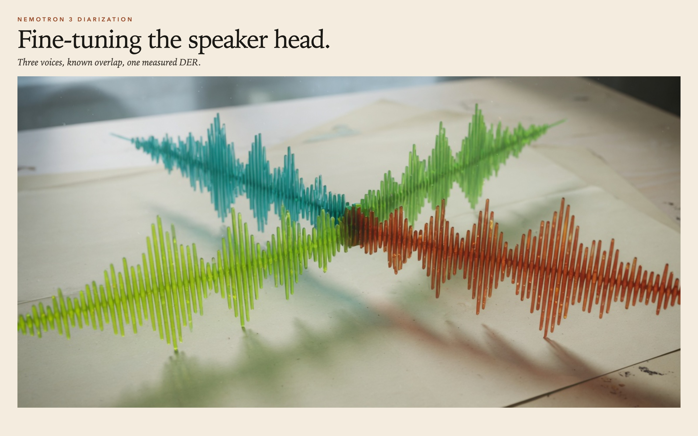
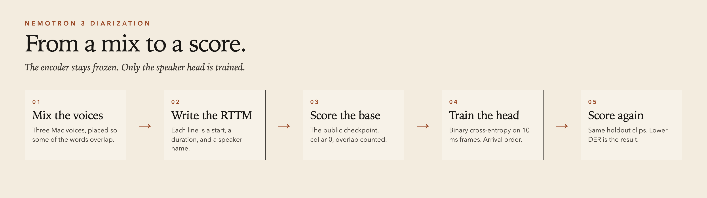

<p align="center">
  
</p>

# Fine-tuning Nemotron 3 Diarization

A measured fine-tune of the speaker head on [`nvidia/Nemotron-3-Diarization`](https://huggingface.co/nvidia/Nemotron-3-Diarization). The encoder stays frozen. The labels are three Mac voices with scripted overlap.

The write-up is [`BLOG.md`](BLOG.md).

| Split | Clips | Base DER | Tuned DER |
|---|---:|---:|---:|
| Train | 10 | 11.68% | 7.67% |
| Dev | 2 | 2.22% | 1.82% |
| Holdout | 4 | 2.74% | 2.38% |

Collar 0. Overlap counted. Frames are 10 ms. Speech threshold is 0.5. Epoch 6 of 12, chosen on the dev split. Holdout sentences were not in the train clips.

<p align="center">
  
</p>

## Run

The wavs and RTTM files are already in `data/`. The first run downloads the public checkpoint.

```bash
python3 -m venv --system-site-packages .venv
.venv/bin/pip install -r requirements.txt
.venv/bin/python finetune.py
```

`finetune.py` scores the base model, trains the head, and writes `outputs/results.json` and `outputs/classifier.pt`. The table above is that file from the M2 run.

Rebuilding the clips from scratch needs the macOS `say` voices Alice, Daniel, and Anna. Delete `data/manifest.json` and run again.

## What is in the box

```
finetune.py          score, train, save
data/                wavs, RTTM, manifests
outputs/results.json the measured run
outputs/classifier.pt  the speaker head
```

The NVIDIA weights are not in git. Load them from Hugging Face. This code is MIT. The model is OpenMDW 1.1.
